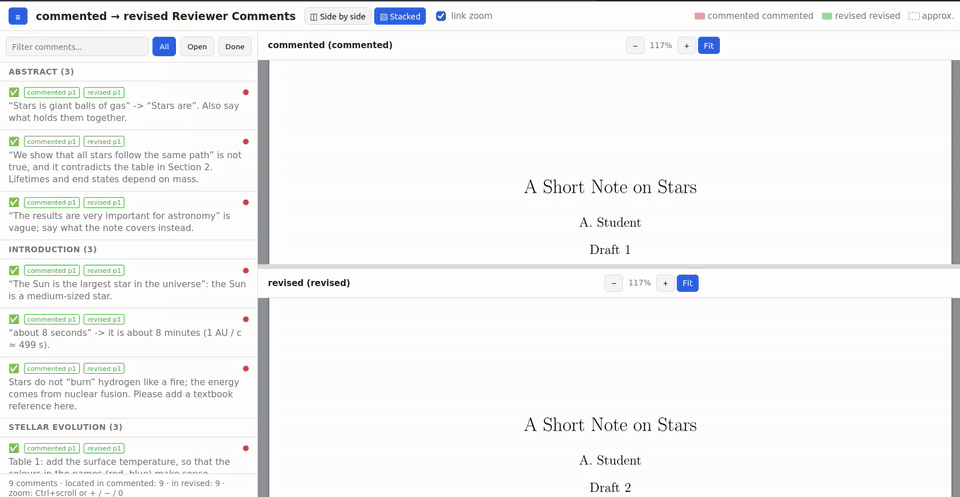

# revview
*A Revision Viewer for the Scientific Text*  

<!--**Fast, Interactive Revision of Scientific Text**  -->
**Every reviewer comment, your reply and your revision on one screen.**



*[Full-quality video](tutorial/tut.webm)*

Produce a GUI, where an author's first draft, the reviewer's comments, the author's feedback on the comments,
and the final revised text based on the reviewer's comments, produced by the author, all are visible
in a single interactive scene for fast and effective communication and production of the final version.
<!--
A Claude Code skill that links each reviewer comment to the passage it refers to in the
**commented** manuscript and to the matching passage in the **revised** one. It builds a static
side-by-side viewer with both places highlighted on the PDF pages.
-->

## Install


```bash
python3 -m pip install --user --upgrade pip   # old pips (e.g. Ubuntu 22.04's 22.0) install it as 'UNKNOWN'
python3 -m pip install --user './revview[images,annotations]'   # path to this folder
revview install-skill                         # writes ~/.claude/skills/revview/SKILL.md
```

`revview` is installed in `~/.local/bin`<!--, which must be on your PATH-->. Then restart Claude Code.

To uninstall:

```bash
rm -r ~/.claude/skills/revview
python3 -m pip uninstall revview
```

## Use


New to revview? Start with the [tutorial](tutorial/README.md), or watch the
[tutorial video](tutorial/tut.webm).
<!--
In Claude Code, type `/revview` or ask in plain words:

> Compare `paper_v2.tex` (commented) with `paper_v3.tex` using the comments in `feedback.md`.

Each version can be a `.tex`, a `.pdf`, or both.  

a one-page paper about stars in two
versions, with a comments file, that builds a viewer in one command.

The comments come from a Markdown file in the
format below. <!--Other formats (JSON, PDF annotations, `\todo` macros)Further formats are described in
[REFERENCE.md](REFERENCE.md).

## Comments file format

````markdown
Abstract

- [x] "For validation purposes" -> do you mean verification here?
  <span style="color:red">
  Changed to verification throughout.
  </span>
- [ ] The main contribution is unclear.

Introduction

- [x] "sliver, high-aspect-ratio cells": cells can also turn inside out.
  <span style="color:red">Added inside-out faces and negative-volume cells.</span>
````

- A line on its own between blank lines (`Abstract`) starts a section. `# Abstract` also works.
- Each `- [ ]` (open) or `- [x]` (done) item is one comment. It continues until the next item.
- Write your reply to a comment inside `<span style="color:red">...</span>` (any colour), below
  the comment. Everything else is the reviewer's text. Replies are shown under the comment in the
  viewer, and Claude uses them to find where the revision addressed it.
-->


## Requirements
- [Claude Code](https://claude.com/claude-code), 
- Python ≥ 3.9 and 
- poppler-utils
(`pdftotext`, `pdftoppm`). 
- Optional: `latexmk` (TeX without a PDF) and `pandoc` (Markdown/math in comments).


## How It Works

Claude matches every comment, splitting long lists across parallel subagents, and builds
`OUT/index.html`. Open that file in a browser. Ask for a zip to get an archive you can share.

See [REFERENCE.md](REFERENCE.md) for the command-line tool, the offline and API modes, and all options.